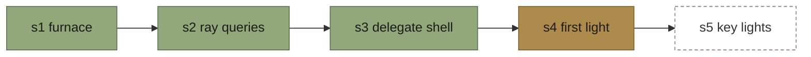
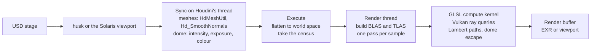
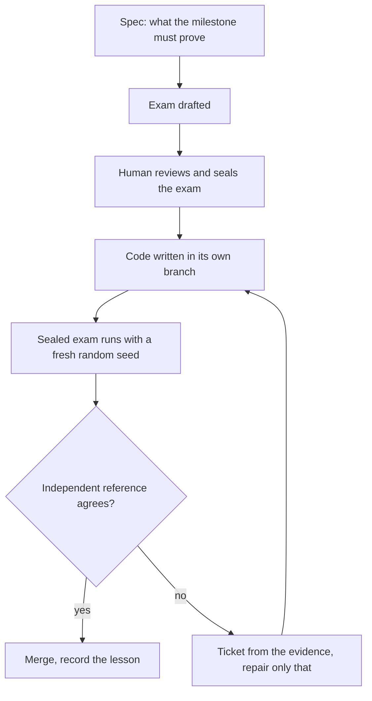

<picture>
  <source media="(prefers-color-scheme: dark)" srcset="assets/logo/logo-dark.svg">
  
</picture>

<br>

<code>HOUDINI 22 / SOLARIS / HYDRA / VULKAN RAY QUERIES</code>

Houdini_RT is a real-time GPU path tracer for SideFX Houdini 22. It plugs into Solaris as a Hydra render delegate called HoudiniRT, traces light with Vulkan inline ray queries, and is built one milestone at a time, each one judged by a sealed test script that the code cannot argue with.

Reading path: read 01 and 05 first. 02 to 04 explain where it stands, how it works and how it is built; 06 to 10 are reference. About six minutes.

---

###  01. What it is

Houdini_RT is a render delegate: the piece of software Houdini hands a scene to when you pick a renderer in the Solaris viewport or run `husk` on the command line. This one is a **progressive path tracer that runs on the GPU**. It syncs meshes, the camera and a dome light from Hydra, builds a ray-tracing acceleration structure on the graphics card, and refines the image one sample per pixel per pass until it converges.

Think of it as a second opinion next to Karma. You point the same USD stage at it, and it answers the same physical question, how much light reaches the camera through each pixel, with a small, readable engine you can take apart.

---

###  02. Where it stands

Four milestones make up first light. Three are merged; the fourth passes its sealed exam and is being landed.

| Milestone | What it proves | State |
|---|---|---|
| s1 furnace | The OpenPBR shading math runs on the RTX 4090 and matches a CPU reference table | Merged |
| s2 ray queries | Rays hit triangles: hit distance, shadows and a closed-box energy test match analytic answers | Merged |
| s3 delegate shell | The GPU image reaches Houdini through a Hydra delegate and `husk` | Merged |
| s4 first light | The usd-wg Utah teapot under a dome light matches Karma CPU | Exam sealed 2026-11-11; code passes it on 8 of 8 seeds; landing |

On the s4 exam the delegate's census of the scene matches the stage exactly, doubling the dome doubles the image, coverage matches Karma to 0.00007 of the frame, and **the picture lands within 0.11 percent of Karma's brightness**, with a FLIP score of 0.019 to 0.031 against a ceiling of 0.045.



---

###  03. How it works

Hydra syncs each mesh and the dome light on Houdini's thread. The render pass then flattens the scene into one world-space mesh. The render thread uploads it to the GPU and runs **one compute kernel that traces every path with inline ray queries**. Nothing touches the GPU during sync, and the render thread can pause and resume at any pass.



A path starts at the camera, bounces off surfaces, and gathers light when it escapes to the dome. Each bounce multiplies what the path carries by the surface colour, so a grey surface passes on half the light and a white one nearly all of it. Averaging thousands of such paths per pixel is the whole renderer.

---

###  04. How it is built

Every milestone starts with an exam, not with code. A human reviews and seals a test script; only then is code written, by a local model in a night loop or in a Claude Code session. **A script judges every attempt, never a model.**



Each exam is keyed to a fresh random number, so the code cannot memorise an answer, and it checks the program against something the program cannot produce itself: a CPU table, an analytic value, or Karma CPU rendering the same stage. Exit codes say which stage failed, from 11 for a broken build to 16 for a wrong picture.

It works like a driving test with a different route every time. You cannot pass by learning the route; you can only pass by being able to drive.

---

###  05. Quick start

The delegate source lives on the `claude/s4-first-light` branch until s4 lands on `main`. From Git Bash, with the Vulkan SDK installed and `VULKAN_SDK` set:

01. Get the code on the working branch.

```
git clone https://github.com/JosephOIbrahim/Houdini_RT.git
cd Houdini_RT
git checkout claude/s4-first-light
```

02. Build and stage the plugin against the Houdini 22.0.429 HDK.

```
cmake -S src/hdRT -B build/s4/cmake -G "Visual Studio 17 2022" -A x64 \
      -DCMAKE_PREFIX_PATH="C:/Program Files/Side Effects Software/Houdini 22.0.429/toolkit/cmake"
cmake --build build/s4/cmake --config Release
cmake --install build/s4/cmake --config Release --prefix build/plugin_stage
```

03. Point Houdini at the staged plugin and render a stage.

```
export PXR_PLUGINPATH_NAME="$(cygpath -m "$PWD/build/plugin_stage")"
"/c/Program Files/Side Effects Software/Houdini 22.0.429/bin/husk.exe" -R HdRTRendererPlugin -o out.exr your_stage.usda
```

04. Or start Houdini with the same `PXR_PLUGINPATH_NAME` and pick HoudiniRT in the Solaris viewport's renderer menu.

05. Run the sealed exam yourself: `bash verify/s4_firstlight.sh $RANDOM`. It prints `PASS` or names the stage that failed.

---

###  06. Requirements

| Need | Version used |
|---|---|
| Windows | 11 |
| SideFX Houdini with the HDK | 22.0.429 (the exams pin this build) |
| GPU with Vulkan ray queries | NVIDIA RTX 4090 |
| Vulkan SDK | 1.4 (for `glslangValidator` and the validation layer) |
| Compiler | Visual Studio 2022 Build Tools, CMake 3.20 or later |
| Shell | Git for Windows (the exams are bash scripts) |
| Night loop only | Node 20, Ollama 0.14 or later |

---

###  07. What is where

| Path | What it is |
|---|---|
| `CLAUDE.md` | The operating contract every agent reads first |
| `specs/build-spec.md` | Each milestone's deliverable, exam contract and boundary |
| `verify/` | The sealed exams and their judges |
| `drafts/sealed/` | Every exam as it was sealed, with its notes |
| `src/furnace/` | Steps 1 and 2: standalone Vulkan kernels |
| `src/hdRT/` | The render delegate (on `integration` and `claude/s4-first-light`) |
| `orchestrator/`, `agents/` | The night loop and the prompts of its roles |
| `DECISIONS.md` | Lessons and decisions, dated and append-only |
| `third_party/` | Reference code and the test asset, each with its own licence |

The branch `main` holds the contract, the exams and the loop. `integration` holds merged milestone code. `claude/s4-first-light` holds the s4 work until it lands.

---

###  08. Limits today

Surfaces are Lambertian with a constant `displayColor`, and the only light is an untextured dome. There are no textures, no other lights, no instancing, no subdivision, and no outputs besides colour yet. **The picture cannot yet tell smooth normals from flat ones**, because a uniform dome lights a Lambertian surface the same from every side; the exam enforces smooth normals by reading the source until s5 brings a light with a direction.

Pause and resume work in the Solaris viewport and were checked by hand; the exams check them only by reading the source.

---

###  09. What comes next

01. Land s4 on `main` through the loop's own judge.

02. s5 key lights: distant, rect and sphere lights, which also let an exam see smooth versus flat normals.

03. A Houdini package, so HoudiniRT appears in the renderer menu without environment variables.

04. OpenPBR materials from MaterialX, using the BSDF that already passed the s1 furnace.

05. Textures and UVs, then an importance-sampled HDRI dome.

---

###  10. Licence and credits

Houdini_RT is released under the Apache License 2.0; see `LICENSE`. Code under `third_party/` keeps its own licence: Pixar's hdEmbree example delegate (Tomorrow Open Source Technology License 1.0), Sascha Willems' Vulkan samples (MIT), and the usd-wg Utah teapot (CC0). Adobe's OpenPBR BSDF (Apache 2.0) is used from its own checkout and is not included.

Houdini, Solaris, Karma and the HDK are products of SideFX. This project is independent and not affiliated with or endorsed by SideFX. Karma appears here only as a reference renderer in the exams.

Houdini_RT is a small GPU path tracer for Houdini 22 that earns each step by passing a sealed, randomised exam against an independent reference.
