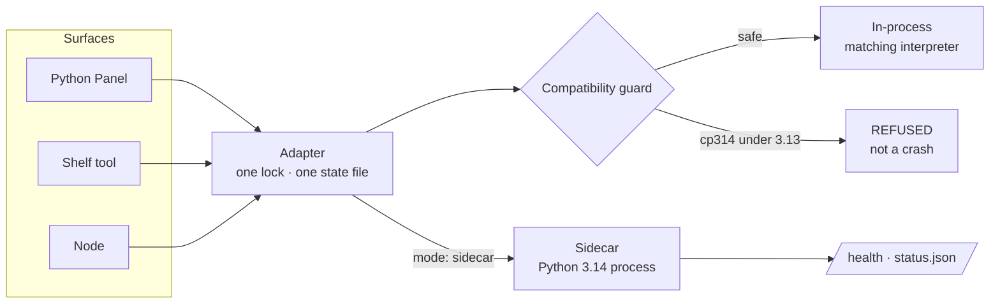
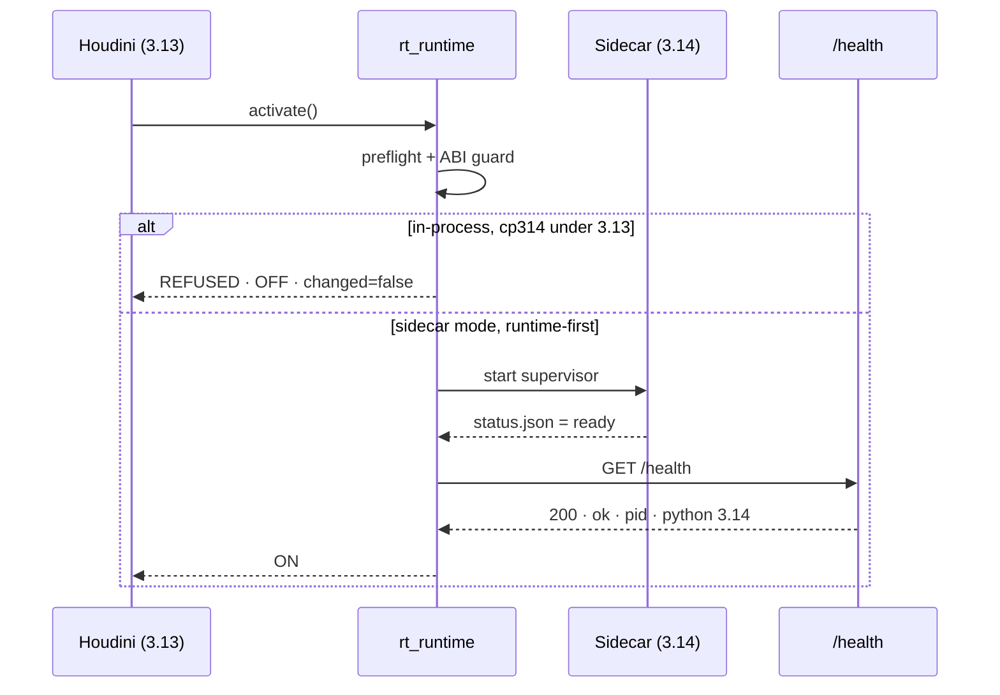

<p align="center">
  
</p>

# RT Toggle

**Houdini 22 runtime on/off for HoudiniRT — v0.1.7**

## The answer first

**Houdini 22.0.429 runs Python 3.13.10. HoudiniRT is a Python 3.14 distribution.**

The toggle does **not** load the 3.14 tree into Houdini's interpreter. It guards
it, refuses it, and runs it as a supervised sidecar instead.

**What works today:** sidecar ON is proven live — `/health` returns 200 and a
real `run_turn` returns complete. The in-process guard correctly refuses the
cp314 tree. A 3.13 in-process sibling runtime is planned, not installed.

**Tests:** 277 pass on Python 3.14; 260 pass with skips on 3.12.

---

## What works today

- **Sidecar mode.** `activate()` starts a CPython 3.14 process with runtime-first
  packages, waits for ready, checks `/health`, and reports ON. `deactivate()`
  stops it gracefully.
- **In-process guard.** Any attempt to load the full 3.14 `site-packages` under
  Houdini's 3.13 interpreter is refused with the ABI blocker named. Refusal is a
  designed outcome, not a crash.
- **One turn at a time, from any surface.** The panel has a prompt field, a run
  button and a cancel button; the shelf has **RT Turn** and **RT Turn Cancel**
  tools; the node has `rt_prompt`, Run Turn and Cancel Turn. Every one submits
  with `wait_ms=0` and polls `/turn/<id>`. The panel polls on a Qt timer and
  never blocks; the shelf and node have no timer, so they poll for a bounded
  window (`RT_TURN_POLL_S`, default 2 s) and leave the turn running after that.
  Offline by default; `RT_SIDECAR_LIVE_MODEL=1` turns the same controls live.
- **Three surfaces, one look.** The panel and the shelf’s three tools share a
  small SVG icon family in `houdini/icons/`. A Python Panel (primary), a shelf
  tool set (secondary), and an optional node. The viewport camera dropdown is
  not an extension point.
- **One adapter.** Every surface calls the same process-wide adapter, so they
  share one lock, one state file and one set of path bookkeeping.

---

## Install in 5 steps

Full detail, exact `hou` calls and uninstall are in **[INSTALL.md](INSTALL.md)**.

`%PREF%` = `hou.homeHoudiniDirectory()` (usually
`%USERPROFILE%\Documents\houdini22.0`). `%HOUDINI_RT_ROOT%` = the HoudiniRT
distribution root.

1. **Make it importable.** Set `HOUDINI_RT_ROOT` in `%PREF%\houdini.env`; copy
   `houdini/packages/rt_toggle.json` to `%PREF%\packages\`. Restart.
2. **Install the panel.** Copy `houdini/rt_panel.pypanel` to
   `%PREF%\python_panels\`. Keep the interface name `RT_Toggle`.
3. **Install the shelf.** Copy `rt_shelf.shelf` and `rt_shelf.py` together to
   `%PREF%\toolbar\`; set `RT_TOGGLE_ROOT` if the pair is copied out of the
   extension.
4. **Add the pane menu entry.** Copy `houdini/PaneTabTypeMenu.xml` to `%PREF%\`.
   It is a supplement; merge the single `<actionItem>` if one already exists.
5. **Open it.** Restart, choose **New Pane Tab Type → RT Toggle**, or click the
   **RT Toggle** shelf button.

**Never** put `%HOUDINI_RT_ROOT%\Lib\site-packages` on `PYTHONPATH`, in a package
JSON, in `houdini.env`, or in a startup script. The guard exists to keep it out.

The icons resolve through `RT_TOGGLE_ROOT`, which the package JSON now sets.
When the shelf pair is copied into `%PREF%\toolbar\` instead, set that variable
too, or the tools fall back to no icon.

For putting the controls over the viewport itself, see
**[docs/ARTIST_LAUNCH.md](docs/ARTIST_LAUNCH.md)** — HUD handles are the native
mechanism, and the recipe is there.

---

## How it works



**Boundaries.** Surfaces never touch `sys.path`. The adapter owns state. The
guard makes the one safety decision. The sidecar is a separate process, not a
second interpreter inside Houdini.

## Activation



---

## Runtime configuration

`rt_toggle.json` at the extension root names the target. Relative paths resolve
against that file's folder.

```json
{
  "version": 1,
  "default": "houdini_rt",
  "targets": {
    "houdini_rt": {
      "home": "../..",
      "python_version": "3.14",
      "site_packages": "../../Lib/site-packages",
      "allow_pure_python_only": false
    }
  }
}
```

Add `"mode": "sidecar"` plus a `sidecar` block to run the 3.14 process instead of
touching `sys.path`. The block carries the launcher, host script, state folder,
package precedence, timeouts and `entry_point`. A complete two-target example is
`verification/rt_toggle_sidecar.json`: its default is the sidecar target, and
its second target exists to prove the in-process refusal.

For an isolated check, point `RT_TOGGLE_CONFIG` at that file before launching
Houdini. `get_adapter()` then uses it, with state beside the config, rather than
editing the extension's default target.

**Package precedence.** `runtime-first` is the default and wins imports. Base-first
is available only with `"allow_degraded_base_first": true`, and every result is
labelled `DEGRADED`.

---

## ABI policy

`rt_runtime/compat.py` compares the host ABI with the target's declared Python and
scans filenames for ABI-specific binaries. It never imports what it inspects.

**Strict by default.** A target whose declared version differs from the host is
refused, even with no compiled files. Under Houdini's `cp313`, the default 3.14
target is refused with the mismatch named.

**Opt-in per target.** `"allow_pure_python_only": true` permits a mismatch only
when the scan finds no compiled modules, with a warning that 3.14-only syntax or
stdlib APIs may still fail.

---

## Sidecar: what ON means

- A supervised CPython 3.14 process, started with the runtime tree in front.
- A lock, a heartbeat and an atomically written `status.json`.
- A loopback HTTP control surface with a per-launch token: `/health`, `/status`,
  `/shutdown`, and a turn service — `POST /turn`, `GET /turn/<id>`,
  `POST /cancel`. One turn at a time, cooperative cancel, bounded results.
- `entry_point` reaches the host as `--entry-point`. The host invokes a no-arg
  target, a one-context target, or the `run_turn` shape with a guarded client and
  dispatcher.
- The default probe is offline. `RT_SIDECAR_LIVE_MODEL=1` uses the configured
  Anthropic endpoint and returns a real `AgentTurnResult`.

---

## Tests

```powershell
py -3.12 -m pytest tests -q -p no:cacheprovider
```

- **Python 3.12 (local, Windows):** 260 passed, 18 skipped (3.14-only sidecar
  lifecycle tests, plus the POSIX permission test).
- **Python 3.14 (local, Windows):** 277 passed, 1 skipped (the POSIX
  permission test).
- **Latest recorded CI before this change:** 230 passed, 17 skipped on Ubuntu
  3.12 and 3.13; 244 passed, 3 skipped on Windows 3.14. Run `43301551119` at
  `cfc81da`; all four jobs passed.

The local and CI counts differ by host, not by code: local runs have `synapse`
available, Ubuntu runs the POSIX permission test that Windows skips, and the
Windows runner has no `synapse`. Current CI figures are recorded after the run
at this release commit.

The suite needs no Houdini; `tests/fake_hou.py` stands in for `hou`.

---

## Proven vs untested

**Proven live in hython 22.0.429:**

- The panel installs; `interfaceByName("RT_Toggle")` resolves.
- The cp314 target is refused: `safe=false`, 108 blockers (104 before the
  2026-11-11 repair), no cp314 import.
- The shelf XSD validates; the tool script reports one refusal line.
- The node builds and its callback function writes REFUSED and reverts.
- The state file survives restart, reports ERROR, re-activates, and deactivates.
- The pane-menu supplement has one item at the right anchor.
- RT-first sidecar: ON, `/health` 200, `run_turn` complete, graceful OFF.

**Manual, not machine-verified:**

- Pane render, shelf click, parm event dispatch, gear-menu duplicate and uninstall.
- The panel's turn control has not been clicked in Houdini. The client and
  poller are tested against a real loopback server, and the widget wiring is
  checked statically; the click itself is still a person.
- The planned 3.13 in-process sibling runtime (G8) — no tree has been installed.
- A network model turn without credentials; the offline probe is the default.

`verification/MATRIX.md` and `INSTALL_CHECKS.md` keep the per-check status.

---

## Layout

```
rt_toggle/
├─ README.md
├─ INSTALL.md · DESIGN.md · CHANGELOG.md
├─ rt_toggle.json
├─ rt_runtime/
│  ├─ adapter.py · compat.py · session.py
│  ├─ sidecar_adapter.py
│  └─ sidecar/                host, supervisor, loopback transport
├─ houdini/                   panel, shelf, node, pane menu, package
├─ docs/
│  ├─ CLAIMS_VS_REFERENCE.md
│  └─ rt-toggle-mark.svg
├─ tests/
└─ verification/
```

The state file `.rt_toggle_state.json` is generated at runtime and is not tracked.

## License

License: TBD. No license file is included; licensing is the owner's decision.

---

*RT Toggle v0.1.7 · Myth and Logic*
