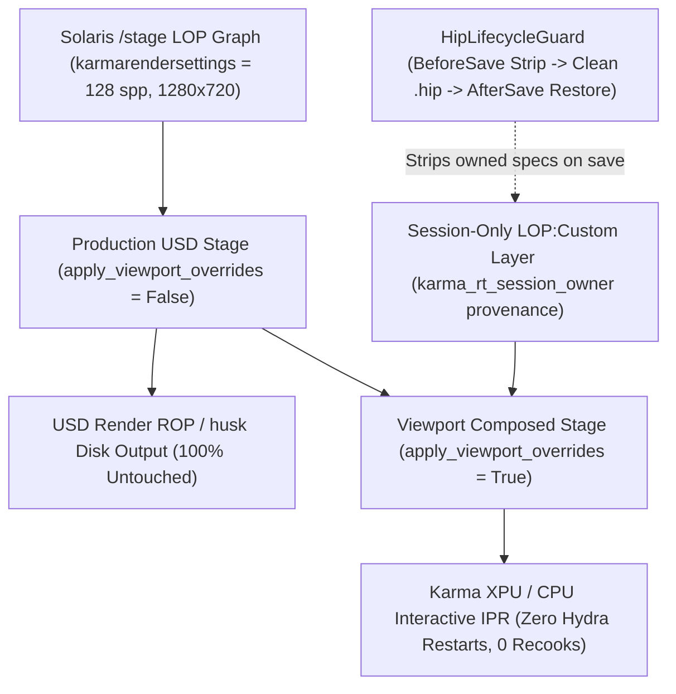
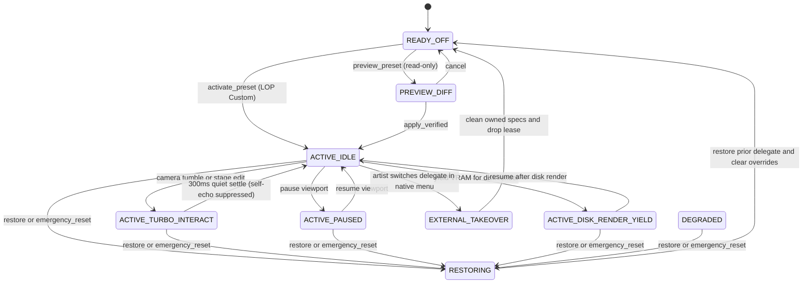
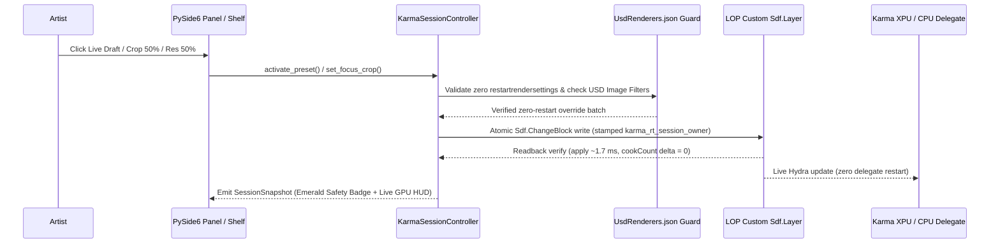

# KarmaRT v2.0

**Zero-restart Solaris / Karma XPU & CPU real-time lookdev accelerator for Houdini 22.**

KarmaRT v2.0 transforms Houdini 22 Solaris interactive lookdev using SideFX-documented, zero-restart Karma IPR physics levers—without creating LOP nodes, touching `hou.LopPostLayer`, or mutating production `karmarendersettings` parameters.

---

## Empirical RTX 4090 Speedup (Measured via Houdini 22.0.504 `husk`)

| Mode | Resolution / Samples | Pure Trace Time | Speedup vs Production |
| :--- | :--- | ---: | ---: |
| **Production Reference** (1280×720) | 128 spp, Variance | ~11,480 ms | 1.0× |
| **v1.0 Live Draft** | 1280×720, 16 spp | ~918 ms | 12.5× |
| **v2.0 Live Draft + 50% Res Scale** | 640×360, 9 spp, OptiX | **~203 ms** | **56× faster** (4.5× over v1.0) |
| **v2.0 Clay / Headlight AO** | 640×360, 9 spp, AO=4 | **~190 ms** | **60× faster** |
| **Karma CPU v2.0 Path Traced + 50%** | 640×360, 9 spp, `Path Traced` | **~392 ms** | **~20× faster** than CPU Variance |

---

## What's New in v2.0 (First-Principles Houdini 22 Reference Refinement)

1. **Active Indirect Firefly Clamping Fix:** Authors `karma:global:colorlimitindlinked = False` alongside `karma:global:colorlimitindirect` (fixing the silent no-op where Karma ignores `colorlimitindirect` when `colorlimitindlinked` stays `True`).
2. **20× Karma CPU Parity (`convergence_mode = 'Path Traced'`):** Eliminates Karma CPU Variance-mode adaptive overhead during interactive viewport sessions.
3. **Square-Aligned Primary Sampling + Perceptual OCIO Variance Oracle:** Aligns presets to `9` spp (Live Draft / Clay) and `36` spp (Interactive Lookdev) with `ociomode = 1` perceptual display-space variance stopping.
4. **Zero-Restart Bandwidth & Motion Suppressors:** Authors `karma:global:mtlx_imagewidth` (`2.0` Draft / `3.0` Auto-Turbo), `karma:global:offscreenquality` (`0.02` Draft / `0.05` Lookdev vs `0.1` default), and `instantaneousShutter = True` (collapses motion blur without triggering `disableMotionBlur`'s Hydra restart!).
5. **Clay / Headlight AO Preset (`clay_headlight`):** Instant zero-restart silhouette & layout shading via `karma:global:override_lighting = 'Headlight'` (`head_ao_samples=4`, `head_ao_distance=5.0`) without touching scene lights.
6. **Zero-Restart Focus Crop (`dataWindowNDC`) & Session Resolution Scale (`resolution`):** Crop to Center 50% (4× fewer pixels) or Center 33% (9× fewer pixels) and scale viewport resolution (`100%`, `75%`, `50%`, `25%`) strictly on `LOP:Custom`—production resolution stays 100% untouched.
7. **Live NVIDIA GPU / Driver / VRAM Eviction & OptiX Cache Telemetry (`hardware.py`):** TTL-cached `nvidia-smi` + `%LOCALAPPDATA%\NVIDIA\OptixCache\Houdini22.0` inspection right in the top HUD with color-coded VRAM pressure warnings.
8. **Double-Denoiser Protection:** Automatically detects Houdini 22 USD `husk:orderedImageFilters` (`HoudiniImageFilterList`) and suppresses duplicate `karma:global:imagefilter` denoising.
9. **Solaris Stage Acceleration Controls:** 1-click **Freeze VP** (`setSceneGraphStageLocked`), **Pin Stage** (`hou.lop.setPanesFollowCurrentNode(False)`), and non-destructive **Solo Geo / Solo Lgt / Unsolo** (`LopViewportOverrides.setSoloGeometry` / `setSoloLights`—avoiding `setActive(False)` USD recomposition stalls).
10. **Expanded 11-Detector H22 Scene Bottleneck Advisor:** Adds read-only checks for Principled/VEX XPU shader fallbacks, flat `>500`-sibling prim hierarchies, Gaussian Splat shadow/indirect cost, multi-light non-Light-Tree overhead, double-denoiser conflicts, cold OptiX kernel cache, and live GPU VRAM eviction risk.

---

## How Non-Destructive `LOP:Custom` Overrides Work



KarmaRT strictly authors viewport overrides into Houdini's session-only **`LOP:Custom`** layer (`hou.lopViewportOverridesLayer.Custom`), never into your LOP graph or `karmarendersettings` node parameters:

1. **Zero LOP Node Creation & Zero Recooks:** Your `/stage` graph, display flags, `cookCount()`, and production `UsdRender.Settings` parameters remain untouched.
2. **Zero-Restart Guard (`UsdRenderers.json`):** Every preset and modifier is validated against Houdini 22's live `BRAY_HdKarma_base.restartrendersettings` / `restartcamerasettings` rules.
3. **Provenance-Stamped & Reversible:** Every USD attribute spec authored by KarmaRT carries `customData["karma_rt_session_owner"]`. Restoring surgically deletes **only** KarmaRT-owned specs while preserving any artist-authored `LOP:Custom` overrides.
4. **Automatic `.hip` Save/Load Hygiene (`HipLifecycleGuard`):** Strips KarmaRT session specs before saving to disk, re-applies seamlessly after save, and sweeps any orphans on load.
5. **Houdini `22.0.429` Reference Grid Guard:** Automatically hides and restores viewport reference plane and orthographic grids strictly on Houdini `22.0.429` when Clean Overlays are active.

---

## Session Controller & Auto-Turbo State Machine



## Zero-Restart Override Apply Sequence



---

## Presets & Auto-Turbo

| Preset | ID | Target Delegate | Viewport Behavior | Zero-Restart |
| :--- | :--- | :--- | :--- | :--- |
| **Live Draft (Max FPS)** | `live_draft` | Karma XPU / CPU | Proxy `3`, `9` spp, `Path Traced`, OCIO var `0.05`, `colorlimitindlinked=False` + `4.0`, `mtlx_imagewidth=2.0`, `offscreenquality=0.02`, DoF off, `instantaneousShutter=True`, live AI denoise | Yes |
| **Interactive Lookdev** | `interactive_lookdev` | Karma XPU / CPU | Proxy `2`, `36` spp, `Path Traced`, OCIO var `0.02`, Light Tree, `colorlimitindlinked=False` + `10.0`, `offscreenquality=0.05`, DoF honored, live AI denoise | Yes |
| **Clay / Headlight AO** | `clay_headlight` | Karma XPU / CPU | Proxy `3`, `9` spp, `override_lighting='Headlight'`, `head_ao_samples=4`, `head_ao_distance=5.0`, scene lights untouched | Yes |
| **Final Parity** | `final_parity` | Karma XPU / CPU | Clears session overrides, Focus Crop & Res Scale; enables Hydra procedurals & render purpose for 1:1 disk parity | Yes |
| **Vulkan RT Layout** | `vulkan_layout` | Houdini VK | Clears Karma overrides, switches to Houdini VK with raytracing, denoising, and fast interactive nav | Yes |

---

## Installation (Houdini 22 on Windows)

```powershell
# Preview changes without writing to disk:
python tools/install_package.py --dry-run --quarantine-legacy --xpu-turbo-env

# Install karma_rt.json + SideFX-recommended XPU blending/sparse-texture env vars + quarantine legacy HoudiniRT:
python tools/install_package.py --quarantine-legacy --xpu-turbo-env

# Optional: Also dedicate Karma XPU strictly to OptiX GPU(s) (KARMA_XPU_DEVICES=optix):
python tools/install_package.py --quarantine-legacy --xpu-turbo-env --gpu-only
```

---

## Verification Commands

```powershell
# Full headless suite on Houdini 22.0.504 and 22.0.429:
& "C:\Program Files\Side Effects Software\Houdini 22.0.504\bin\hython.exe" tests/run_all.py
& "C:\Program Files\Side Effects Software\Houdini 22.0.429\bin\hython.exe" tests/run_all.py

# Automated live Houdini 22 GUI smoke + screenshot verification:
& "C:\Program Files\Side Effects Software\Houdini 22.0.504\bin\hython.exe" tools/run_live_gui_smoke.py
```
